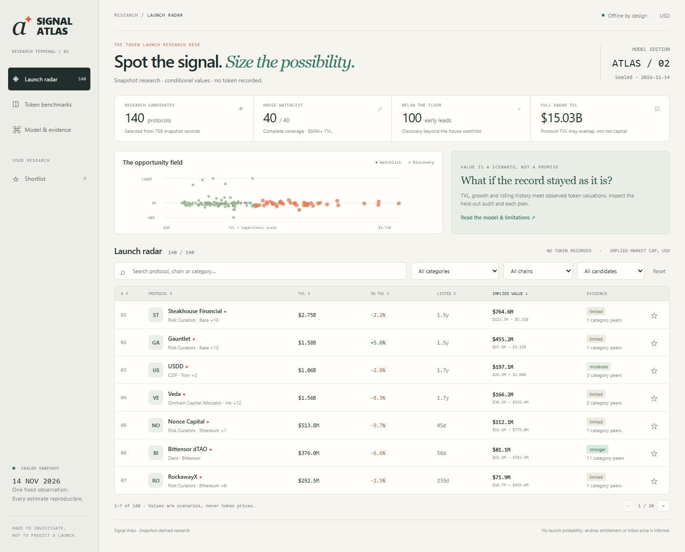

# Signal Atlas

[](https://make.fun/bounty/token-radar-01?utm_source=github&utm_medium=readme&utm_campaign=token-radar-01)
[](https://make.fun/bounty/token-radar-01/leaderboard?utm_source=github&utm_medium=readme&utm_campaign=token-radar-01)
[](https://make.fun/bounty/token-radar-01?utm_source=github&utm_medium=readme&utm_campaign=token-radar-01)

An offline token-launch research desk: 140 protocols, an empirical valuation model, visible uncertainty, and concrete conditional participation plans. Signal Atlas covers all 40 house-watchlist protocols and adds 100 candidates below the $50M TVL floor. Atlas 02 adds a reproducible held-out audit and complete provenance for all 88 calibration tokens, without changing the original valuation parameters or candidate rankings.



## Run

Node.js 22.18 or later is the only runtime dependency. The compiled dashboard and genuine browser screenshots are committed. No installation, network access, API key, wallet or build step is needed to run the entry.

```sh
node main.ts --input /path/to/token-radar-01-kit/input/snapshot.json --output out
```

Open `out/dashboard/index.html` directly in a browser. The page works from disk with no server. Search, sort columns, filter categories/chains/watchlist/discovery, save a local shortlist, and open every protocol's detailed research note. Recorded-token benchmarks and the complete methodology have separate views.

The competition command is simply `node main.ts`: it reads `/input/snapshot.json` and writes `/output/board.json`, `/output/dashboard/`, `/output/screenshots/` and `/output/dossier.json`. `MAKEFUN_OUTPUT_DIR` may override the output directory. `--preview` builds the board and dashboard before screenshots are available; a submission run does not use that flag.

## What the model claims

The implied value is a conditional **market-cap analogue**, not FDV, a token price, a launch probability or an expected airdrop payout. “No token recorded” describes the sealed record and does not prove that no token exists today.

1. Build a peer set with positive observed market cap and TVL. Exclude wrapped/staked/bridged products, versioned pools and chain valuations. Keep the largest-TVL eligible record per token ID to reduce duplicate market caps. This snapshot supplies 88 distinct token benchmarks.
2. Winsorize log market-cap/TVL ratios at the global 10th and 90th percentiles. Blend each category's median with the global median in log space; the category weight is `n / (n + 6)`. Thin categories therefore borrow more evidence from the global population.
3. Multiply TVL by that empirical ratio, a bounded growth factor, and a modest listing-history factor:

```text
growth = sqrt(1 + clamp(change_7d, -60, 100) / 100)
history = 0.75 + 0.25 * min(listing_age_days, 730) / 730
implied_value = round(TVL * peer_ratio * growth * history)
```

Missing growth is neutral. A missing listing date uses the median known listing age of the eligible candidate pool. Listing history measures how long DefiLlama tracked a protocol; it is not protocol age or proof of time without a token. The UI shows these inputs for every row, with rounded displayed factors.

Scenario bounds use category/global 20th–80th-percentile peer ratios and widen when peer evidence is sparse or metadata is missing. Each detail shows its actual lower/upper ratios, widening factor, and missing-field drivers. They are deliberately broad and are **not statistical confidence intervals**. Evidence labels report data support, never confidence that a token will launch.

The snapshot has no revenue, fees, token supply, vesting, value-capture, rewards or eligibility data. TVL can be recursive and overlap across protocols. Token market capitalization need not accrue from protocol TVL. All of those limits are visible in the dashboard.

## Held-out cross-sectional audit

For each of the 88 observed calibration tokens, withhold that token's entire key (`gecko_id`, otherwise uppercase symbol, otherwise slug) before fitting the remaining 87. Deduplication happens first; a smaller record for the held-out token cannot re-enter the fold. Recompute winsorization, category quantiles and global shrinkage in every fold. A category with no training peers uses the global distribution.

Apply the unchanged model to the held-out protocol's TVL, growth and listing history. Missing dates retain the original candidate pool's **411-day median fallback**; observed-token ages do not replace that production assumption. Compare the estimate and scenario band with the recorded market cap:

- **55/88 scenario coverage (62.5%)**, with 33 observed caps outside their bands.
- **4.784869× median multiplicative error**, where each fold's error is `max(predicted/observed, observed/predicted)`.
- **1.001221× median predicted/observed ratio**. This directional statistic does not cancel the large individual errors.

These are same-snapshot transfer checks on existing tokens, **not launch validation, a time-series backtest, or expected future performance**. The parameters were not tuned against these results. Model & evidence exposes all 88 folds; Token benchmarks exposes every source slug and token key. The source timestamp and input SHA-256 identify the sealed observation. `board.json` carries the full audit beside the ranked rows.

## Participation plans

One shared generator supplies the board and browser plans, with 20 category routes. Plans name the protocol and its first recorded chain, specify research/setup/observation/exit tasks, and separate capital at risk from fee ceilings and time.

Supported assets, official contracts, minimum deposits, current rewards and jurisdictional access are not in the snapshot, so plans require verification. Curator TVL is not assumed to be a standalone product; RWA and private-credit routes start with eligibility. Derivatives, prediction, governance and unknown products default to research or practice. No plan calls an observation window a qualifying period or proposes churn to manufacture activity. The program performs no financial transactions.

## Validate and develop

```sh
# With the kit at ../kit/token-radar-01-kit, or ATLAS_TEST_INPUT set to its snapshot:
node --test tests/*.test.ts

# Optional: after creating out/, regenerate the 3 real screenshots in Chrome:
node tests/browser.mjs out
# Re-run main.ts with the same --input and --output to package those new images.

# Optional: edit readable ui/ source and rebuild committed dashboard assets:
npm install
npm run build:ui
```

`CHROME_PATH` selects a local Chrome/Chromium executable; the browser test defaults to the standard Windows Chrome installation. It opens its own temporary profile. Tests cover deterministic output, all 88 folds independently refitted from masked source records, a synthetic duplicate-token leakage case, singleton category fallback, and missing-age handling. They also check exact board/dashboard dollar values, all 140 detail scenario drivers and plans, every peer's provenance, the official dossier, screenshot caps, filters, sorting, shortlist, empty results and mobile layout. The browser check asserts no console exceptions or external network requests and saves an additional local `out/audit-review.jpg` outside the submitted screenshot set. Intermediate floating-point factors allow machine-precision differences between Node and Chrome; integer estimates and bands must match exactly.

`ui/` contains readable browser source; `dashboard/` contains the precompiled distribution. The compiler is a development dependency only. `lib/model.ts` selects records and ranks them; `ui/math.js` supplies the same calibration, estimates and audit to Node and the page. `main.ts` stores raw inputs once, using lossless category/chain dictionaries and explicit string references. The visible shared arithmetic reconstructs all values and folds, keeping the complete dashboard within the dossier's 65,536-byte text budget without opaque compression or data truncation. `vendor/makefun-board.ts` is the unchanged official dossier library.

The sealed input and development outputs are not committed. The MIT license covers this repository; the source snapshot comes from the competition kit's fixed DefiLlama observation dated 2026-11-14.

Built for [make.fun's token launch radar bounty](https://make.fun/bounty/token-radar-01). [Explore make.fun via our referral link](https://make.fun/?ref=phymwxzj&utm_source=github&utm_medium=readme&utm_campaign=token-radar-01).
